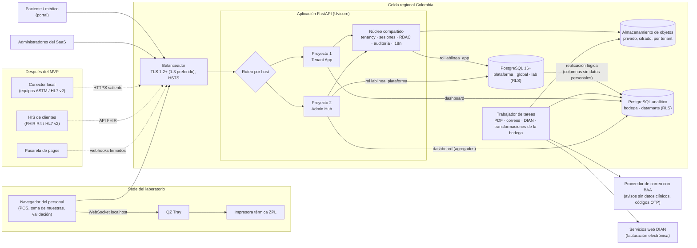
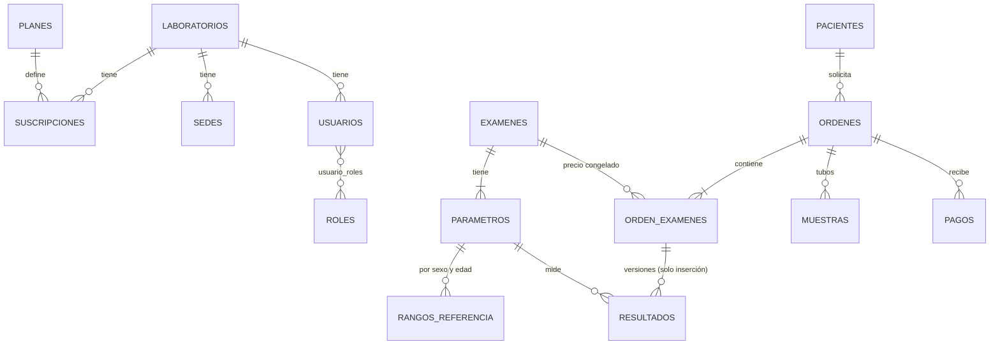

# Plan de desarrollo de LabLineaWeb

- **Fecha:** 2026-10-12
- **Base:** specs aceptadas en [specs/](README.md). Este plan organiza su construcción; si algo aquí difiere de una spec, prevalece la spec.

LabLineaWeb son dos sistemas en una misma plataforma:

| | **Proyecto 1 — Tenant App** | **Proyecto 2 — Admin Hub** |
|---|---|---|
| Usuarios | Personal del laboratorio, pacientes, médicos | Dueños y operadores del SaaS |
| Acceso | `<laboratorio>.<dominio>` | `admin.<dominio>` |
| Datos | Clínicos y financieros de **un** laboratorio (esquema `lab`, con RLS) | Laboratorios, licencias, facturación del SaaS (esquema `plataforma`); **métricas agregadas, nunca datos clínicos** |
| Specs | [funcional/0002](funcional/0002-pos-ordenes-caja.md), [0003](funcional/0003-muestras-impresion.md), [0004](funcional/0004-resultados-validacion-entrega.md) | [funcional/0005](funcional/0005-plataforma-saas-suscripciones.md) |

---

## 1. Arquitectura y topología



### Decisiones de topología

- **Un solo código y un solo despliegue**, con dos sub-aplicaciones FastAPI montadas por host (`Host` de Starlette). Comparten el núcleo, pero cada una tiene sus rutas, plantillas y permisos. Separarlas en dos servicios se evalúa solo si la carga lo exige.
- **Cuatro roles de base de datos**, cada uno con lo mínimo necesario:

  | Rol | Uso | Puede |
  |-----|-----|-------|
  | `lablinea_owner` | Migraciones (Alembic) | Dueño de los esquemas; nunca lo usa la aplicación |
  | `lablinea_app` | Tenant App | Esquema `lab` bajo RLS; lectura de `global` |
  | `lablinea_plataforma` | Admin Hub | Esquema `plataforma`; lectura de `global`; **sin acceso a `lab`** |
  | `lablinea_metricas` | Trabajador de métricas | `BYPASSRLS`, pero `SELECT` solo sobre columnas no clínicas (`tenant_id`, fechas, estados, montos); escribe en `plataforma.metricas_diarias` |

- **Cómo ve el Admin Hub los indicadores de todos los laboratorios:** desde el datamart de plataforma de la bodega analítica, solo con agregados ([infraestructura/0010](infraestructura/0010-analitica-bodega-datos.md), *propuesta*). Nunca consulta `lab`. Si la bodega no se aprueba, se usa la alternativa de la tabla `plataforma.metricas_diarias` (sección 2).
- **Dominio:** `<laboratorio>.lablinea.cionetworks.com` y `admin.lablinea.cionetworks.com`, con cookies `__Host-` ([infraestructura/0005](infraestructura/0005-arquitectura-saas-multitenant.md)).
- **Tareas en segundo plano** (PDF, correos, métricas): cola de trabajos sobre PostgreSQL (`SELECT … FOR UPDATE SKIP LOCKED`), con reintentos. Evita agregar Redis. *La librería se fija en una spec en la etapa 3.*

---

## 2. Esquema de base de datos

Núcleo del modelo, aplicando [infraestructura/0007](infraestructura/0007-base-de-datos.md). Se muestran las tablas centrales; el resto (convenios, paquetes, caja, estaciones, rangos) sigue el mismo patrón.

### 2.1 Relaciones



### 2.2 DDL núcleo

```sql
-- =====================================================================
-- Esquemas y función de contexto
-- =====================================================================
CREATE EXTENSION IF NOT EXISTS citext;           -- correos sin distinguir mayúsculas

CREATE SCHEMA plataforma AUTHORIZATION lablinea_owner;
CREATE SCHEMA global     AUTHORIZATION lablinea_owner;
CREATE SCHEMA lab        AUTHORIZATION lablinea_owner;

-- Tenant de la transacción. La aplicación ejecuta en cada transacción:
--   SET LOCAL app.current_tenant = '<tenant_id>';
--   SET LOCAL app.current_user_id = '<uuid>';  SET LOCAL app.client_ip = '<ip>';
-- Sin tenant definido devuelve NULL o '' y ninguna política deja pasar filas.
CREATE FUNCTION lab.tenant_actual() RETURNS text
LANGUAGE sql STABLE AS $$ SELECT current_setting('app.current_tenant', true) $$;

-- =====================================================================
-- plataforma (Admin Hub) — sin RLS, solo accesible por lablinea_plataforma
-- =====================================================================
CREATE TABLE plataforma.laboratorios (
    id              BIGINT GENERATED ALWAYS AS IDENTITY PRIMARY KEY,
    uuid            UUID NOT NULL DEFAULT gen_random_uuid() UNIQUE,
    tenant_id       TEXT NOT NULL UNIQUE CHECK (tenant_id ~ '^[a-z0-9_]{3,50}$'),
    nombre_comercial TEXT NOT NULL,
    identificador_fiscal TEXT NOT NULL,
    pais_codigo     CHAR(3) NOT NULL REFERENCES global.paises(codigo),
    subdominio      TEXT NOT NULL UNIQUE,
    dominio_propio  TEXT UNIQUE,                       -- opcional, después del MVP
    estado          TEXT NOT NULL DEFAULT 'ACTIVO'
                    CHECK (estado IN ('ACTIVO','SUSPENDIDO','CANCELADO')),
    creado_en       TIMESTAMPTZ NOT NULL DEFAULT now()
);

CREATE TABLE plataforma.planes (
    id              BIGINT GENERATED ALWAYS AS IDENTITY PRIMARY KEY,
    codigo          TEXT NOT NULL UNIQUE,              -- DEMO, MENSUAL, ANUAL, AD_HONOREM…
    nombre          TEXT NOT NULL,
    duracion_dias   INTEGER,                           -- NULL = indefinida
    max_usuarios    INTEGER,
    funcionalidades JSONB NOT NULL DEFAULT '{}'        -- activación de módulos por plan
);

CREATE TABLE plataforma.suscripciones (
    id              BIGINT GENERATED ALWAYS AS IDENTITY PRIMARY KEY,
    laboratorio_id  BIGINT NOT NULL REFERENCES plataforma.laboratorios(id),
    plan_id         BIGINT NOT NULL REFERENCES plataforma.planes(id),
    inicia_en       TIMESTAMPTZ NOT NULL DEFAULT now(),
    vence_en        TIMESTAMPTZ,
    estado          TEXT NOT NULL DEFAULT 'ACTIVA'
                    CHECK (estado IN ('ACTIVA','SUSPENDIDA','VENCIDA','CANCELADA')),
    renovacion_automatica BOOLEAN NOT NULL DEFAULT true
);

-- Agregados diarios sin datos clínicos, calculados por lablinea_metricas.
CREATE TABLE plataforma.metricas_diarias (
    laboratorio_id  BIGINT NOT NULL REFERENCES plataforma.laboratorios(id),
    dia             DATE NOT NULL,
    ordenes         INTEGER NOT NULL DEFAULT 0,
    pacientes_activos INTEGER NOT NULL DEFAULT 0,
    resultados_entregados INTEGER NOT NULL DEFAULT 0,
    PRIMARY KEY (laboratorio_id, dia)
);

-- =====================================================================
-- lab (Tenant App) — RLS en TODAS las tablas
-- =====================================================================
CREATE TABLE lab.usuarios (
    id              BIGINT GENERATED ALWAYS AS IDENTITY PRIMARY KEY,
    uuid            UUID NOT NULL DEFAULT gen_random_uuid() UNIQUE,
    tenant_id       TEXT NOT NULL,
    email           CITEXT NOT NULL,
    password_hash   TEXT NOT NULL,                     -- Argon2id
    totp_secreto_cifrado BYTEA,
    tarjeta_profesional TEXT,                          -- obligatoria para validar resultados
    tipo            TEXT NOT NULL CHECK (tipo IN ('PERSONAL','PACIENTE','MEDICO')),
    estado          TEXT NOT NULL DEFAULT 'ACTIVO',
    creado_en       TIMESTAMPTZ NOT NULL DEFAULT now(),
    UNIQUE (tenant_id, email),
    UNIQUE (tenant_id, id)                             -- destino de FK compuestas
);
-- Roles y permisos (lab.roles, lab.usuario_roles, lab.rol_permisos con CRUD
-- por módulo + acciones especiales) siguen el mismo patrón; ver infraestructura/0008.

CREATE TABLE lab.pacientes (
    id              BIGINT GENERATED ALWAYS AS IDENTITY PRIMARY KEY,
    uuid            UUID NOT NULL DEFAULT gen_random_uuid() UNIQUE,
    tenant_id       TEXT NOT NULL,
    tipo_documento  TEXT NOT NULL,                     -- de la configuración del país
    numero_documento TEXT NOT NULL,
    nombres         TEXT NOT NULL,
    apellidos       TEXT NOT NULL,
    sexo            CHAR(1) NOT NULL CHECK (sexo IN ('M','F')),
    fecha_nacimiento DATE NOT NULL,
    email           CITEXT,
    telefono        TEXT,
    usuario_id      BIGINT,                            -- acceso al portal
    creado_en       TIMESTAMPTZ NOT NULL DEFAULT now(),
    UNIQUE (tenant_id, tipo_documento, numero_documento),
    UNIQUE (tenant_id, id),
    FOREIGN KEY (tenant_id, usuario_id) REFERENCES lab.usuarios (tenant_id, id)
);

-- Autorización de tratamiento de datos (Ley 1581): versión del texto aceptado y revocación.
CREATE TABLE lab.autorizaciones_datos (
    id              BIGINT GENERATED ALWAYS AS IDENTITY PRIMARY KEY,
    tenant_id       TEXT NOT NULL,
    paciente_id     BIGINT NOT NULL,
    version_texto   TEXT NOT NULL,
    otorgada_en     TIMESTAMPTZ NOT NULL DEFAULT now(),
    revocada_en     TIMESTAMPTZ,
    FOREIGN KEY (tenant_id, paciente_id) REFERENCES lab.pacientes (tenant_id, id)
);

CREATE TABLE lab.examenes (
    id              BIGINT GENERATED ALWAYS AS IDENTITY PRIMARY KEY,
    tenant_id       TEXT NOT NULL,
    codigo          TEXT NOT NULL,
    nombre          TEXT NOT NULL,
    seccion         TEXT NOT NULL,
    tecnica_defecto TEXT,
    codigo_cups     TEXT,
    codigo_loinc    TEXT,
    activo          BOOLEAN NOT NULL DEFAULT true,
    UNIQUE (tenant_id, codigo),
    UNIQUE (tenant_id, id)
);
-- lab.parametros, lab.rangos_referencia (sexo, edad_min_dias, edad_max_dias,
-- normal y crítico) y lab.tarifas siguen el mismo patrón; ver funcional/0004.

CREATE TABLE lab.ordenes (
    id              BIGINT GENERATED ALWAYS AS IDENTITY PRIMARY KEY,
    uuid            UUID NOT NULL DEFAULT gen_random_uuid() UNIQUE,
    tenant_id       TEXT NOT NULL,
    numero          BIGINT NOT NULL,                   -- consecutivo visible, por tenant
    paciente_id     BIGINT NOT NULL,
    sede_id         BIGINT NOT NULL,
    estado          TEXT NOT NULL DEFAULT 'BORRADOR'
                    CHECK (estado IN ('BORRADOR','PRE_CERRADA','PAGADA','ANULADA')),
    moneda          CHAR(3) NOT NULL,
    tasa_cambio     NUMERIC(14,6) NOT NULL DEFAULT 1,
    total           NUMERIC(14,2) NOT NULL DEFAULT 0,
    precerrada_en   TIMESTAMPTZ,
    precerrada_por  BIGINT,
    creada_en       TIMESTAMPTZ NOT NULL DEFAULT now(),
    UNIQUE (tenant_id, numero),
    UNIQUE (tenant_id, id),
    FOREIGN KEY (tenant_id, paciente_id) REFERENCES lab.pacientes (tenant_id, id)
);
CREATE INDEX ON lab.ordenes (tenant_id, creada_en);
CREATE INDEX ON lab.ordenes (tenant_id, estado);
CREATE INDEX ON lab.ordenes (tenant_id, paciente_id);

CREATE TABLE lab.orden_examenes (
    id              BIGINT GENERATED ALWAYS AS IDENTITY PRIMARY KEY,
    tenant_id       TEXT NOT NULL,
    orden_id        BIGINT NOT NULL,
    examen_id       BIGINT NOT NULL,
    valor_unitario_historico NUMERIC(14,2) NOT NULL,   -- congelado al pre-cerrar
    cantidad        SMALLINT NOT NULL DEFAULT 1,
    validado_en     TIMESTAMPTZ,
    validado_por    BIGINT,                            -- usuario con tarjeta profesional
    UNIQUE (tenant_id, id),
    FOREIGN KEY (tenant_id, orden_id)  REFERENCES lab.ordenes  (tenant_id, id),
    FOREIGN KEY (tenant_id, examen_id) REFERENCES lab.examenes (tenant_id, id)
);

-- Resultados: solo inserción. Cada corrección es una fila nueva que apunta a la anterior.
CREATE TABLE lab.resultados (
    id              BIGINT GENERATED ALWAYS AS IDENTITY PRIMARY KEY,
    tenant_id       TEXT NOT NULL,
    orden_examen_id BIGINT NOT NULL,
    parametro_id    BIGINT NOT NULL,
    version         INTEGER NOT NULL DEFAULT 1,
    reemplaza_a     BIGINT REFERENCES lab.resultados(id),
    motivo_correccion TEXT,
    valor_numerico  NUMERIC(18,6),
    valor_texto     TEXT,
    bandera         TEXT NOT NULL DEFAULT 'NORMAL'     -- INTERNA: nunca al paciente
                    CHECK (bandera IN ('NORMAL','BAJO','ALTO','CRITICO_BAJO','CRITICO_ALTO','ANORMAL')),
    nota_interna    TEXT,                              -- INTERNA: nunca al paciente
    ingresado_por   BIGINT NOT NULL,
    ingresado_en    TIMESTAMPTZ NOT NULL DEFAULT now(),
    UNIQUE (tenant_id, orden_examen_id, parametro_id, version),
    FOREIGN KEY (tenant_id, orden_examen_id) REFERENCES lab.orden_examenes (tenant_id, id)
);
CREATE INDEX ON lab.resultados (tenant_id, parametro_id, ingresado_en);  -- tendencias

-- Auditoría: solo inserción, particionada por mes, protegida como dato clínico.
CREATE TABLE lab.auditoria (
    id              BIGINT GENERATED ALWAYS AS IDENTITY,
    tenant_id       TEXT NOT NULL,
    tabla           TEXT NOT NULL,
    operacion       TEXT NOT NULL,                     -- INSERT, UPDATE, DELETE, READ
    registro_id     BIGINT,
    usuario_id      TEXT,
    ip              INET,
    antes           JSONB,
    despues         JSONB,
    ocurrido_en     TIMESTAMPTZ NOT NULL DEFAULT now(),
    PRIMARY KEY (id, ocurrido_en)
) PARTITION BY RANGE (ocurrido_en);
```

### 2.3 RLS, inmutabilidad y permisos

```sql
-- Política estándar, aplicada por migración a cada tabla de lab.
DO $$
DECLARE t text;
BEGIN
  FOR t IN SELECT tablename FROM pg_tables WHERE schemaname = 'lab' LOOP
    EXECUTE format('ALTER TABLE lab.%I ENABLE ROW LEVEL SECURITY', t);
    EXECUTE format('ALTER TABLE lab.%I FORCE ROW LEVEL SECURITY', t);
    EXECUTE format($p$
      CREATE POLICY aislamiento_tenant ON lab.%I
        USING      (tenant_id = lab.tenant_actual())
        WITH CHECK (tenant_id = lab.tenant_actual())
    $p$, t);
  END LOOP;
END $$;

GRANT USAGE ON SCHEMA lab TO lablinea_app;
GRANT SELECT, INSERT, UPDATE ON ALL TABLES IN SCHEMA lab TO lablinea_app;
-- Resultados y auditoría: solo inserción y lectura, también a nivel de permisos.
REVOKE UPDATE, DELETE ON lab.resultados, lab.auditoria FROM lablinea_app;

-- Segunda barrera: trigger que rechaza cambios aunque alguien otorgue el permiso.
CREATE FUNCTION lab.rechazar_modificacion() RETURNS trigger LANGUAGE plpgsql AS $$
BEGIN
  RAISE EXCEPTION 'La tabla % es de solo inserción', TG_TABLE_NAME;
END $$;
CREATE TRIGGER resultados_inmutables BEFORE UPDATE OR DELETE ON lab.resultados
  FOR EACH ROW EXECUTE FUNCTION lab.rechazar_modificacion();

-- Orden congelada: fuera de BORRADOR solo se permite avanzar de estado.
CREATE FUNCTION lab.proteger_orden() RETURNS trigger LANGUAGE plpgsql AS $$
BEGIN
  IF OLD.estado <> 'BORRADOR' AND (
       NEW.total IS DISTINCT FROM OLD.total OR
       NEW.paciente_id IS DISTINCT FROM OLD.paciente_id OR
       NEW.moneda IS DISTINCT FROM OLD.moneda) THEN
    RAISE EXCEPTION 'La orden % está %, no se puede modificar', OLD.numero, OLD.estado;
  END IF;
  RETURN NEW;
END $$;
CREATE TRIGGER ordenes_congeladas BEFORE UPDATE ON lab.ordenes
  FOR EACH ROW EXECUTE FUNCTION lab.proteger_orden();
```

**Prueba obligatoria** (ya implementada en la etapa 0, `tests/test_db.py`): recorre `pg_class` y falla si alguna tabla de `lab` no tiene `relrowsecurity` y `relforcerowsecurity` activos o le falta la política `aislamiento_tenant`.

---

## 3. Estructura del proyecto

```
LabLineaWeb/
├── app/
│   ├── main.py                    # crea la app y monta tenant/ y admin/ por host
│   ├── core/                      # núcleo compartido
│   │   ├── config.py              # settings desde .env
│   │   ├── db.py                  # engines por rol; sesión con SET LOCAL de tenant, usuario e IP
│   │   ├── tenancy.py             # resuelve el tenant desde el subdominio (nunca desde la petición)
│   │   ├── seguridad.py           # Argon2id, TOTP, OTP por correo, sesiones, CSRF, cabeceras
│   │   ├── permisos.py            # RBAC: CRUD por módulo + acciones especiales
│   │   ├── auditoria.py           # auditoría de lecturas
│   │   ├── i18n.py                # textos externalizados, zonas horarias
│   │   └── tareas.py              # cola de trabajos en PostgreSQL
│   ├── modelos/
│   │   ├── plataforma.py          # SQLAlchemy: laboratorios, planes, suscripciones…
│   │   ├── global_.py             # países, monedas, tipos de documento
│   │   └── lab/                   # pacientes, órdenes, muestras, resultados…
│   ├── tenant/                    # PROYECTO 1 — Tenant App
│   │   ├── rutas/                 # pacientes, ordenes, caja, muestras, resultados, portal, configuracion
│   │   ├── servicios/             # reglas de negocio (precierre, agrupación de tubos, banderas…)
│   │   └── templates/tenant/
│   ├── admin/                     # PROYECTO 2 — Admin Hub
│   │   ├── rutas/                 # laboratorios, planes, suscripciones, facturacion, metricas, salud
│   │   ├── servicios/             # alta de laboratorios, ciclo de suscripción
│   │   └── templates/admin/
│   ├── informes/                  # generación de PDF
│   │   ├── generador.py
│   │   ├── vistas.py              # modelos de vista SIN campos internos
│   │   └── plantillas/            # base_informe.html, resultados.html, informe.css
│   ├── fhir/                      # mapeo del modelo a recursos FHIR R4
│   ├── importador/                # catálogo de Lablinea (Access)
│   ├── templates/                 # base.html y componentes compartidos (tablas, formularios, gráficas)
│   └── static/                    # css/, js/ (htmx, Chart.js, qz-tray), img/
├── migrations/                    # Alembic (rol lablinea_owner)
├── trabajador.py                  # proceso de tareas en segundo plano
├── scripts/                       # crear_bd_local.sql, datos sintéticos
├── tests/
│   ├── unit/                      # reglas de negocio puras
│   ├── integracion/               # con PostgreSQL de prueba
│   ├── aislamiento/               # tenant A vs tenant B, por cada módulo
│   └── seguridad/                 # permisos, cabeceras, CSRF, auditoría
├── specs/
└── CLAUDE.md
```

**Regla de dependencias:** `tenant/` y `admin/` dependen de `core/` y `modelos/`, nunca entre sí. `admin/` no importa modelos de `lab/` (salvo para el alta de un laboratorio, que crea su configuración inicial con el tenant fijado).

---

## 4. Plan de desarrollo paso a paso

**Modo de trabajo:** todo se construye y prueba en local; la publicación se decide después ([infraestructura/0011](infraestructura/0011-calidad-pruebas-entorno-local.md)). Cada etapa dura aproximadamente un sprint de 2 semanas.

**Regla de cierre:** ninguna etapa se da por terminada sin pasar la **compuerta de calidad** de la spec 0011 (funcional, seguridad interna, seguridad externa y, cuando aplique, rendimiento) y sin su **informe de cierre** en `specs/etapas/`. Abajo se listan, por etapa, los pasos y las pruebas **específicas** que se suman a esa compuerta común.

| Bloque | Etapas | Fases del [MVP](funcional/0007-alcance-mvp.md) |
|---|---|---|
| A. Fundaciones | 0–3 | 1 (base) y 2 (seguridad) |
| B. Admin Hub | 4–5 | 1 (laboratorios, licencias, suscripciones) |
| C. Tenant App | 6–14 | 3 (POS, caja, facturación), 4 (muestras), 5 (resultados) |
| D. Analítica y cierre del MVP | 15–19 | Dashboard completo y cierre |
| E. Publicación | 20 | Pendiente de decidir hosting |

---

### Bloque A — Fundaciones

#### Etapa 0 — Herramientas, base de datos y CI · *cerrada el 2026-10-12 ([informe](etapas/etapa-00.md))*

Lo construido: configuración, `sesion_tenant` con `SET LOCAL`, Alembic con la migración 0001, guardián de RLS, CI con PostgreSQL 18 (11 pruebas).

Pasos para cerrarla:
1. Agregar a `requirements-dev.txt`: `pytest-cov`, `ruff`, `bandit`, `pip-audit`, `hypothesis`; instalar `gitleaks` y `mkcert` con Homebrew.
2. Crear `scripts/verificar.sh` y sumarlo a la CI.
3. Generar certificados locales con `mkcert` para `lab-a`, `lab-b` y `admin.lablinea.localhost`; agregar esos nombres a `/etc/hosts` (lo hace el usuario); levantar Uvicorn en HTTPS.
4. Pasar el código existente por ruff, bandit y pip-audit, y corregir lo que aparezca.

Pruebas específicas:
- `gitleaks` sobre todo el historial de git (verifica que el `.env` nunca se subió).
- Configuración: la aplicación no arranca si faltan contraseñas; las contraseñas no aparecen en `repr()` ni en logs.
- Migración 0001 baja y sube en limpio en la CI.

**Cierra cuando:** `verificar.sh` en verde local y en la CI, servidor HTTPS local operativo e informe `etapa-00.md`.

#### Etapa 1 — Base multi-tenant · *cerrada el 2026-10-12 ([informe](etapas/etapa-01.md))*

Pasos:
1. Ampliar `crear_bd_local.sql` con el rol `lablinea_plataforma` (`lablinea_metricas` se pospone a las etapas 15–16).
2. Migración con tablas de `global` (países, monedas, tipos de documento) y de `plataforma` (laboratorios, estado).
3. Middleware de resolución de laboratorio por subdominio; laboratorio desconocido o suspendido → 404.
4. Configuración por país (tipos de documento, moneda, zona horaria, textos legales).
5. Dos laboratorios sintéticos (`lab_a`, `lab_b`) para todas las pruebas siguientes.

Pruebas específicas:
- Cabecera `Host` falsificada, `X-Forwarded-Host` inyectada y subdominios con caracteres extraños → nunca resuelven otro laboratorio.
- El tenant de la petición no se puede cambiar con parámetros, cookies ni cabeceras.
- Cada rol de base de datos solo ve sus esquemas (matriz rol × esquema × operación).
- ZAP pasivo sobre las rutas base: cabeceras de seguridad presentes.

**Cierra cuando:** la compuerta completa está en verde y el informe `etapa-01.md` está escrito.

#### Etapa 2 — Autenticación y autorización · *cerrada el 2026-10-12 ([informe](etapas/etapa-02.md))*

Pasos:
1. Usuarios, roles, permisos CRUD por módulo y acciones especiales ([infraestructura/0008](infraestructura/0008-autenticacion-autorizacion.md)).
2. Contraseñas con Argon2id; segundo factor TOTP y código por correo (SMTP local de captura).
3. Sesiones en servidor con cookie `__Host-`, expiración por inactividad y máxima absoluta.
4. Protección CSRF, cabeceras de seguridad y CSP.
5. Bloqueo por intentos fallidos y límites de envío de códigos.

Pruebas específicas:
- Fuerza bruta de contraseña y de código → bloqueo; los mensajes no revelan si el correo existe.
- Código OTP vencido, reutilizado o de otro usuario → rechazado.
- Fijación de sesión: el identificador cambia al iniciar sesión; cerrar sesión la invalida en el servidor.
- Una sesión de `lab-a` usada en `lab-b` → rechazada.
- Matriz completa rol × permiso con casos positivos y negativos.
- Formularios sin token CSRF o con token de otra sesión → rechazados.
- ZAP **activo y autenticado**.

**Cierra cuando:** la compuerta completa está en verde y el informe `etapa-02.md` está escrito.

#### Etapa 3 — Auditoría, tareas en segundo plano e i18n

Pasos:
1. Spec de la librería de cola de tareas; implementación con reintentos.
2. Triggers de auditoría con antes y después; auditoría de lecturas desde la aplicación; particiones mensuales.
3. Textos externalizados (`es-CO`), zona horaria por país, fechas en UTC.
4. Generador de datos sintéticos.

Pruebas específicas:
- El rol de la aplicación no puede modificar ni borrar la auditoría, ni siquiera con SQL directo.
- La auditoría de `lab-a` no es visible desde `lab-b`.
- Una tarea que falla se reintenta y no se ejecuta dos veces; la cola no mezcla laboratorios.
- Búsqueda automática de datos sintéticos de pacientes en los logs capturados durante las pruebas → cero coincidencias.

**Cierra cuando:** la compuerta completa está en verde y el informe `etapa-03.md` está escrito.

---

### Bloque B — Admin Hub

#### Etapa 4 — Alta de laboratorios y planes

Pasos:
1. Sub-aplicación `admin` por host; usuarios y roles de plataforma.
2. Alta de laboratorio en una transacción: tenant, subdominio, configuración de país, sede inicial y administrador.
3. Planes y activación de módulos por plan.

Pruebas específicas:
- El rol `lablinea_plataforma` no puede leer el esquema `lab` (prueba con SQL directo).
- Un usuario de plataforma no puede iniciar sesión en el subdominio de un laboratorio, ni al revés.
- Un alta que falla a mitad no deja nada creado.
- Módulos no incluidos en el plan → 403 en el laboratorio.

**Cierra cuando:** la compuerta completa está en verde y el informe `etapa-04.md` está escrito.

#### Etapa 5 — Suscripciones, facturación manual y soporte

Pasos:
1. Ciclo de suscripción: vencimiento, suspensión y alertas de renovación.
2. Facturas de la plataforma con pagos manuales y cálculo de saldo.
3. Acceso de soporte: lo autoriza el laboratorio, con tiempo limitado y auditado.

Pruebas específicas:
- Una suscripción vencida bloquea órdenes nuevas, pero no la consulta de resultados ni la exportación.
- El acceso de soporte vence solo y queda auditado; sin autorización → 403.
- Pruebas con `hypothesis` del saldo de facturas con pagos parciales.

**Cierra cuando:** la compuerta completa está en verde y el informe `etapa-05.md` está escrito.

---

### Bloque C — Tenant App

#### Etapa 6 — Catálogo e importador de Lablinea

Pasos:
1. Exámenes, parámetros, unidades, listas de valores, técnicas, requisitos de muestra, tarifas, códigos CUPS.
2. Rangos de referencia por sexo y edad en días, con rangos críticos.
3. Importador de Lablinea con vista previa y marcado de rangos para revisión.

Pruebas específicas:
- El importador con archivos malformados, enormes o con codificaciones raras no se cae ni carga datos a medias.
- Archivos que no corresponden (ejecutables renombrados) → rechazados.
- Las exportaciones a CSV neutralizan fórmulas (inyección CSV).
- Rangos solapados o con huecos → advertencia.

**Cierra cuando:** la compuerta completa está en verde y el informe `etapa-06.md` está escrito.

#### Etapa 7 — Pacientes y Ley 1581

Pasos:
1. Registro de pacientes con documento y país.
2. Autorización de tratamiento de datos versionada; revocación.
3. Derechos del titular: consultar, actualizar, rectificar y suprimir.

Pruebas específicas:
- Sin autorización vigente no se pueden crear órdenes ni procesar datos del paciente.
- UUID de un paciente de `lab-b` usado en `lab-a` → 404 (IDOR).
- Una supresión elimina o anonimiza según la spec y queda auditada.
- Búsqueda de pacientes sin inyección SQL ni enumeración.

**Cierra cuando:** la compuerta completa está en verde y el informe `etapa-07.md` está escrito.

#### Etapa 8 — Órdenes y POS

Pasos:
1. Órdenes con estados `BORRADOR` → `PRE_CERRADA` → `PAGADA` / `ANULADA` y trigger de protección.
2. Congelamiento de precios al pre-cerrar.
3. Convenios con tope de descuento, autorización superior y evidencia.
4. Paquetes con comparativo y desglose.

Pruebas específicas:
- Máquina de estados probada con `hypothesis`: ninguna secuencia de operaciones modifica una orden pre-cerrada.
- Modificar precios por SQL directo en una orden pre-cerrada → el trigger lo impide.
- Dos pre-cierres simultáneos de la misma orden → solo uno gana.
- Evidencia: tipo y tamaño validados, sin ejecutables, en almacenamiento privado con URL firmada que vence.
- Locust sobre el POS.

**Cierra cuando:** la compuerta completa está en verde y el informe `etapa-08.md` está escrito.

#### Etapa 9 — Caja

Pasos:
1. Apertura con base, pagos por forma de pago, abonos.
2. Arqueo y cierre irreversible.

Pruebas específicas:
- Un cajero no puede abrir dos cajas; pagos en una caja cerrada → rechazados.
- Cuadre con `hypothesis` (muchas combinaciones de pagos y abonos).
- Pagos concurrentes sobre la misma orden no generan sobrepago.

**Cierra cuando:** la compuerta completa está en verde y el informe `etapa-09.md` está escrito.

#### Etapa 10 — Facturación electrónica I (DIAN)

Pasos:
1. Interfaz `FacturadorElectronico` y su implementación para Colombia.
2. XML UBL 2.1, CUFE/CUDE, QR y firma con certificado de pruebas.
3. Envío al **ambiente de habilitación de la DIAN**, con reintentos.
4. Factura y documento equivalente POS.

Pruebas específicas:
- Los XML validan contra los esquemas del anexo técnico vigente.
- El CUFE calculado coincide con los ejemplos oficiales.
- El certificado nunca se lee desde la base ni queda en logs; en local, archivo fuera del repositorio con permisos 600.
- Inyección XML (XXE) en cualquier dato que entre al XML → neutralizada.
- Reenvío idempotente: un documento no se emite dos veces.

**Cierra cuando:** la compuerta completa está en verde y el informe `etapa-10.md` está escrito.

#### Etapa 11 — Facturación electrónica II

Pasos:
1. Notas crédito y débito.
2. RIPS para aseguradoras.
3. Rangos de numeración con alertas; asistente de habilitación.
4. Facturas de la plataforma a los laboratorios.

Pruebas específicas:
- Set de pruebas de habilitación de la DIAN superado en el ambiente de pruebas.
- RIPS válidos según el formato vigente.
- Numeración agotada o vencida → bloqueo con aviso previo.

**Cierra cuando:** la compuerta completa está en verde y el informe `etapa-11.md` está escrito.

#### Etapa 12 — Muestras e impresión

Pasos:
1. Agrupación de tubos por tipo de muestra y tubo.
2. Códigos de barras y estados de la muestra.
3. Cola de toma por sede con htmx.
4. ZPL y QZ Tray, con firma de las peticiones de impresión.

Pruebas específicas:
- Agrupación probada con `hypothesis`: nunca se supera la capacidad, un examen nunca se divide y nunca se mezclan tubos distintos.
- **Inyección ZPL:** nombres con `^`, `~` y caracteres de control no alteran la etiqueta.
- Solo órdenes `PAGADA` entran a la cola.
- E2E de la cola de toma con dos estaciones simultáneas.

**Cierra cuando:** la compuerta completa está en verde y el informe `etapa-12.md` está escrito.

#### Etapa 13 — Resultados y validación

Pasos:
1. Ingreso de resultados con banderas y notas internas.
2. Versiones de corrección y revalidación.
3. Valores críticos con registro de comunicación.
4. Validación por examen con tarjeta profesional.

Pruebas específicas:
- Resultados: `UPDATE` y `DELETE` imposibles por SQL directo con el rol de la aplicación.
- Evaluación de rangos con `hypothesis` en los bordes de edad, sexo y límites.
- Validar sin tarjeta profesional o sin permiso → rechazado.
- Un valor crítico se notifica aunque la orden tenga saldo.

**Cierra cuando:** la compuerta completa está en verde y el informe `etapa-13.md` está escrito.

#### Etapa 14 — Informe PDF, portal y entrega

Pasos:
1. PDF con WeasyPrint, marca H/L opcional, hash SHA-256 y firma electrónica.
2. Regla de liberación.
3. Portal de pacientes y médicos con tendencias.
4. Aviso por correo (SMTP local de captura).
5. Mapeo a FHIR R4.

Pruebas específicas:
- **Fuga de datos internos:** el PDF, el portal y el correo se analizan automáticamente y no contienen banderas, notas internas ni colores de alerta.
- **SSRF en el PDF:** una plantilla o un logo con URL externa → rechazado.
- HTML inyectado en nombres u observaciones → escapado.
- El correo capturado no contiene datos clínicos.
- Portal: UUID de otra orden, de otro paciente o de otro laboratorio → 404.
- JSON FHIR validado contra R4.
- E2E completo: orden → pago → toma → resultado → validación → aviso → descarga en el portal.

**Cierra cuando:** la compuerta completa está en verde y el informe `etapa-14.md` está escrito.

---

### Bloque D — Analítica y cierre del MVP

#### Etapa 15 — Bodega analítica

Pasos:
1. El usuario cambia `wal_level` a `logical` en su PostgreSQL local, crea `lablinea_dw` y el rol `lablinea_metricas`.
2. Publicación con lista de columnas sin datos personales; suscripción en la bodega.
3. Staging, seudónimos de pacientes y modelo estrella ([infraestructura/0010](infraestructura/0010-analitica-bodega-datos.md)).

Pruebas específicas:
- **Guardián de la bodega:** recorre el catálogo y falla si aparece cualquier columna de nombre, documento, contacto o valor de resultado.
- El seudónimo no se puede revertir sin la clave del laboratorio.
- Una supresión del titular se propaga a la bodega.
- Retraso medido entre una venta y su aparición en la bodega.

**Cierra cuando:** la compuerta completa está en verde y el informe `etapa-15.md` está escrito.

#### Etapa 16 — Datamarts

Pasos:
1. Datamarts de laboratorio (RLS), país y plataforma.
2. Transformaciones incrementales cada pocos minutos.

Pruebas específicas:
- Guardián de RLS también en la bodega.
- Los totales de los datamarts cuadran con la base transaccional (conciliación automática).
- El datamart de plataforma solo contiene agregados.

**Cierra cuando:** la compuerta completa está en verde y el informe `etapa-16.md` está escrito.

#### Etapa 17 — Dashboard del laboratorio

Pasos:
1. Filtros cruzados, comparativos, mapa de calor, desglose por sección y examen, tiempos de respuesta.
2. Alertas antifraude.
3. Indicadores del día desde la base transaccional.

Pruebas específicas:
- Ningún filtro permite ver datos de otro laboratorio (parámetros manipulados).
- Locust: p95 ≤ 300 ms con datos sintéticos de varios años.
- E2E de los filtros con htmx.

**Cierra cuando:** la compuerta completa está en verde y el informe `etapa-17.md` está escrito.

#### Etapa 18 — Dashboard del Admin Hub

Pasos:
1. MRR/ARR, laboratorios activos y suspendidos, volumen por país.
2. Salud del sistema.

Pruebas específicas:
- Desde el Admin Hub no se puede llegar a ningún dato a nivel de paciente.
- Las métricas coinciden con los datos de facturación de la plataforma.

**Cierra cuando:** la compuerta completa está en verde y el informe `etapa-18.md` está escrito.

#### Etapa 19 — Cierre del MVP en local

Pasos:
1. Regresión completa y E2E de todos los flujos.
2. Revisión contra **OWASP ASVS nivel 2**, punto por punto.
3. ZAP activo completo sobre toda la aplicación, autenticado con cada rol.
4. Prueba de carga combinada (POS + validación + dashboard).
5. Respaldo y **restauración verificada** con `pg_dump` / `pg_restore`.
6. Revisión del modelo de amenazas y prueba de penetración interna dirigida.

**Cierra cuando:** cero hallazgos altos o medios abiertos y el informe `etapa-19.md` declara el MVP **listo para publicar**.

---

### Bloque E — Publicación (pendiente de decidir hosting)

#### Etapa 20 — Publicación

Comienza cuando se elija el hosting:
1. Spec de hosting; BAA firmado.
2. Entorno de staging en la nube.
3. Pruebas que no se pueden hacer en local: configuración TLS real, WAF, reglas de red, secretos en el gestor de la nube, restauración en la nube.
4. **Prueba de penetración externa por un tercero.**
5. Piloto con un laboratorio.

---

## 5. Arquitectura de plantillas PDF

Tres principios:

1. **La plantilla no puede filtrar lo que no recibe.** El generador recibe un modelo de vista que **no tiene** bandera ni nota interna ([funcional/0004](funcional/0004-resultados-validacion-entrega.md)). No depende de que la plantilla "se acuerde" de no mostrarlas.
2. **WeasyPrint no descarga nada de internet.** Logos y firmas se leen del almacenamiento del tenant y se pasan embebidos; un `url_fetcher` propio rechaza cualquier otra URL (evita SSRF desde una plantilla configurada por un laboratorio).
3. **Autoescape siempre activo**: un nombre de paciente o una nota no puede inyectar HTML en el informe.

### `app/informes/vistas.py`

```python
from dataclasses import dataclass
from datetime import datetime


@dataclass(frozen=True)
class ParametroInforme:
    nombre: str
    valor: str                 # ya formateado; sin bandera ni nota interna
    marca: str | None          # "H" o "L" solo si el laboratorio activó la marca; nunca la bandera interna
    unidad: str | None
    referencia: str | None     # rango aplicable a la edad y sexo del paciente
    es_titulo: bool = False


@dataclass(frozen=True)
class ExamenInforme:
    nombre: str
    tecnica: str | None
    parametros: list[ParametroInforme]
    validador_nombre: str
    validador_tarjeta: str
    validado_en: datetime
    notas: str | None          # notas aprobadas por el profesional
    corregido: bool = False    # muestra nota de corrección


@dataclass(frozen=True)
class MarcaLaboratorio:
    nombre: str
    logo_data_uri: str | None
    color_primario: str
    color_secundario: str
    marca_agua: str | None
    pie_de_pagina: str | None


@dataclass(frozen=True)
class InformeResultados:
    laboratorio: MarcaLaboratorio
    paciente_nombre: str
    paciente_documento: str
    paciente_edad: str
    paciente_sexo: str
    orden_numero: int
    fecha_toma: datetime
    medico: str | None
    examenes: list[ExamenInforme]
    codigo_verificacion: str   # permite verificar el informe en el portal
```

### `app/informes/generador.py`

```python
import hashlib
from pathlib import Path

from jinja2 import Environment, FileSystemLoader, select_autoescape
from weasyprint import HTML, default_url_fetcher

from app.informes.vistas import InformeResultados

PLANTILLAS = Path(__file__).parent / "plantillas"

entorno = Environment(
    loader=FileSystemLoader(PLANTILLAS),
    autoescape=select_autoescape(["html"]),
)


def _solo_recursos_locales(url: str):
    # Logos y firmas llegan como data: URI; los estilos, desde la carpeta de plantillas.
    if url.startswith("data:") or url.startswith(PLANTILLAS.as_uri()):
        return default_url_fetcher(url)
    raise ValueError(f"Recurso externo no permitido en el informe: {url}")


def generar_pdf(informe: InformeResultados, idioma: str = "es") -> tuple[bytes, str]:
    """Devuelve el PDF y su hash SHA-256 (se guarda para verificar integridad)."""
    html = entorno.get_template("resultados.html").render(informe=informe, idioma=idioma)
    pdf = HTML(
        string=html,
        base_url=PLANTILLAS.as_uri() + "/",
        url_fetcher=_solo_recursos_locales,
    ).write_pdf()
    return pdf, hashlib.sha256(pdf).hexdigest()
```

### `app/informes/plantillas/base_informe.html`

```html
<!doctype html>
<html lang="{{ idioma }}">
<head>
  <meta charset="utf-8">
  <link rel="stylesheet" href="informe.css">
  <style>
    :root {
      --primario: {{ informe.laboratorio.color_primario }};
      --secundario: {{ informe.laboratorio.color_secundario }};
    }
  </style>
</head>
<body>
  <header class="encabezado">
    
      
    
    <div class="laboratorio">{{ informe.laboratorio.nombre }}</div>
    
  </header>

  <footer class="pie">
    {{ informe.laboratorio.pie_de_pagina or "" }}
    <span class="verificacion">Verificación: {{ informe.codigo_verificacion }}</span>
    <span class="paginas"></span>
  </footer>

  
    <div class="marca-agua">{{ informe.laboratorio.marca_agua }}</div>
  

  <main></main>
</body>
</html>
```

### `app/informes/plantillas/resultados.html`

```html



<table class="paciente">
  <tr>
    <th>Paciente</th><td>{{ informe.paciente_nombre }}</td>
    <th>Documento</th><td>{{ informe.paciente_documento }}</td>
  </tr>
  <tr>
    <th>Edad / Sexo</th><td>{{ informe.paciente_edad }} / {{ informe.paciente_sexo }}</td>
    <th>Orden</th><td>{{ informe.orden_numero }}</td>
  </tr>
  <tr>
    <th>Toma</th><td>{{ informe.fecha_toma.strftime("%d/%m/%Y %H:%M") }}</td>
    <th>Médico</th><td>{{ informe.medico or "—" }}</td>
  </tr>
</table>




<section class="examen">
  <h2>{{ examen.nombre }}</h2>
  <p class="tecnica">Técnica: {{ examen.tecnica }}</p>
  
    <p class="correccion">Este resultado reemplaza a una versión anterior.</p>
  

  <table class="resultados">
    <thead>
      <tr><th>Parámetro</th><th>Resultado</th><th>Unidad</th><th>Valor de referencia</th></tr>
    </thead>
    <tbody>
      
        
          <tr class="titulo"><td colspan="4">{{ p.nombre }}</td></tr>
        
          <tr>
            <td>{{ p.nombre }}</td>
            <td class="valor">{{ p.valor }} <span class="marca">{{ p.marca }}</span></td>
            <td>{{ p.unidad or "" }}</td>
            <td>{{ p.referencia or "" }}</td>
          </tr>
        
      
    </tbody>
  </table>

  <p class="notas">{{ examen.notas }}</p>

  <p class="validacion">
    Validado por {{ examen.validador_nombre }} — T.P. {{ examen.validador_tarjeta }}
    — {{ examen.validado_en.strftime("%d/%m/%Y %H:%M") }}
  </p>
</section>


```

### `app/informes/plantillas/informe.css`

```css
@page {
  size: letter;
  margin: 3.2cm 1.8cm 2.2cm;
  @top-center { content: element(encabezado); }
  @bottom-center { content: element(pie); }
}
.encabezado { position: running(encabezado); border-bottom: 2px solid var(--primario); }
.pie { position: running(pie); font-size: 8pt; color: #555; }
.paginas::after { content: "Página " counter(page) " de " counter(pages); }
.logo { height: 1.4cm; }
.marca-agua {
  position: fixed; top: 45%; left: 0; right: 0; text-align: center;
  font-size: 64pt; color: var(--secundario); opacity: .08; transform: rotate(-30deg);
}
.examen { break-inside: avoid; margin-top: .6cm; }
.examen h2 { color: var(--primario); font-size: 12pt; }
.resultados { width: 100%; border-collapse: collapse; font-size: 9.5pt; }
.resultados th { text-align: left; border-bottom: 1px solid var(--primario); }
.resultados tr.titulo td { font-weight: bold; padding-top: .3cm; }
.valor { font-weight: 600; }
.marca { font-weight: 700; font-size: 8pt; }
.correccion { color: #8a5a00; font-style: italic; }
.validacion { font-size: 8.5pt; color: #333; }
```

---

## 6. Diferencias con el documento de requisitos de este plan

| Requisito recibido | Cómo queda | Por qué |
|---|---|---|
| RLS **o** esquema por laboratorio | RLS | [infraestructura/0005](infraestructura/0005-arquitectura-saas-multitenant.md) |
| JWT **o** sesión | Sesión en servidor con cookie; tokens solo para la API FHIR | [infraestructura/0008](infraestructura/0008-autenticacion-autorizacion.md) |
| `users.role` con SUPER_ADMIN, LAB_ADMIN, TECH, PATIENT | Usuarios de plataforma separados de los del laboratorio; roles configurables con permisos por módulo | [infraestructura/0008](infraestructura/0008-autenticacion-autorizacion.md); un SUPER_ADMIN dentro de la tabla del laboratorio rompería el aislamiento |
| `tenants.id` UUID | `tenant_id` legible + `uuid` público | [infraestructura/0007](infraestructura/0007-base-de-datos.md) |
| TLS 1.3 | TLS 1.2 mínimo, 1.3 preferido | Compatibilidad con equipos antiguos de laboratorios |
| Logs de actividad entre laboratorios en el Admin Hub | Solo metadatos y agregados, sin datos clínicos | [infraestructura/0005](infraestructura/0005-arquitectura-saas-multitenant.md) |
| Pipeline de despliegue en la fase 4 | CI desde la etapa 0; todo se prueba en local y la publicación es la etapa 20 | Decidido el 2026-10-12 ([infraestructura/0011](infraestructura/0011-calidad-pruebas-entorno-local.md)) |
| Indicadores de estado y resaltado de rangos en el PDF | Marca `H`/`L` opcional por laboratorio; sin colores ni banderas internas | Decidido el 2026-10-12 ([funcional/0004](funcional/0004-resultados-validacion-entrega.md)) |
| Dashboard ejecutivo del laboratorio | Dashboard interactivo completo en el MVP, sobre una bodega analítica separada | Decidido el 2026-10-12 ([funcional/0006](funcional/0006-gestion-inventarios-costos-dashboard.md), [infraestructura/0010](infraestructura/0010-analitica-bodega-datos.md)) |
| Distribución de comisiones en el Admin Hub | No se construye por ahora | Decidido el 2026-10-12 |
| Facturación e ISAs/aseguradoras | Facturación electrónica directa con la DIAN, con RIPS para aseguradoras | [infraestructura/0009](infraestructura/0009-facturacion-electronica.md) |
